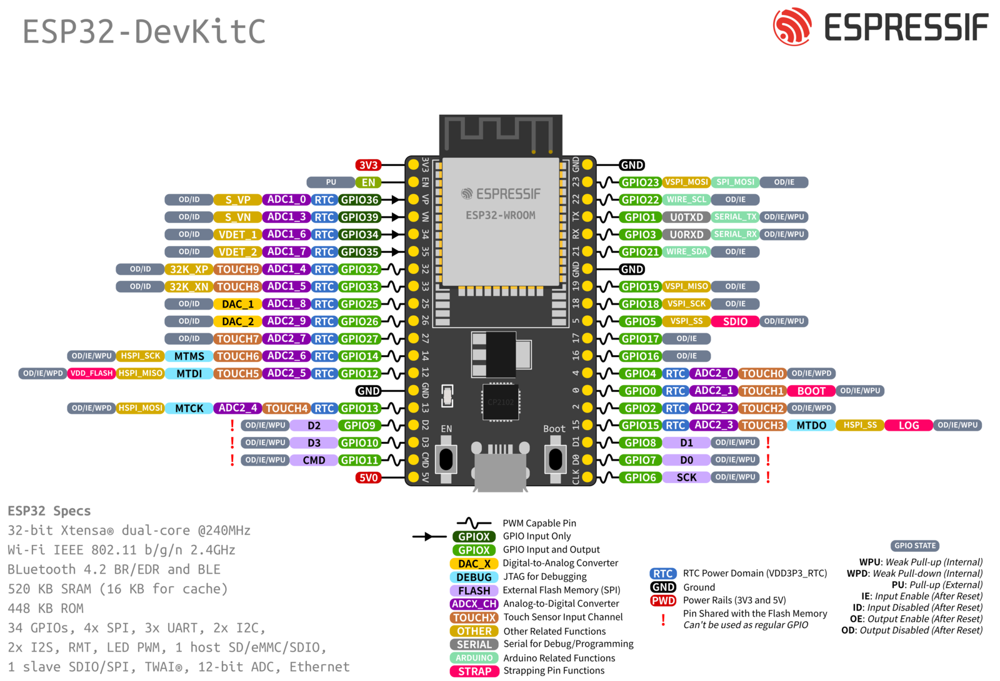

# Autosteel Customs Fingerprint

Repositori ini menampung kode dan ketentuan dalam pengembangan dan implementasi firmware untuk board dengan chip `ESP WROOM 32-U` (ESP32 DevKitC V4). Dikembangkan dengan framework `ESP IDF`. Templat ini diperoleh dari repository [Espressif esp-idf-template](https://github.com/espressif/esp-idf-template) dan telah dimodifikasi pada beberapa bagian untuk menyesuaikan dengan kebutuhan dari firmware yang akan dikembangkan.

## Komponen

### Board

| Spesifikasi | Keterangan                                   |
| ----------- | -------------------------------------------- |
| Board       | DevKit V4 ESP WROOM 32-U (External antenna ) |
| Jumlah Pin  | 38                                           |
| WiFi        | Ya                                           |
| Bluetooth   | Ya                                           |
| Chipset     | Xtensa® 32-bit LX6 CPU Dual Core 240 MHz     |
| Flash       | 4MB                                          |

### Sensor

| Sensor                                  | Jumlah |
| --------------------------------------- | ------ |
| AS608/FPM10A Optical Fingerprint Module | 1      |

### Komponen Lainnya (Aktuator & Lainnya)

| Komponen           | Jumlah |
| ------------------ | ------ |
| LED Blue           | 1      |
| LED Yellow         | 1      |
| LED Green          | 1      |
| LCD 16x2 + I2C     | 1      |
| Active Buzzer 3.3V | 1      |
| RTC DS3231         | 1      |

## Rancangan Perangkat

### Skematik

### Konfigurasi Pin

| Komponen                                | Pin Komponen | Pin Board |
| --------------------------------------- | ------------ | --------- |
| RTC DS3231                              | VCC          | 3.3V      |
|                                         | GND          | GND       |
|                                         | SCL          | GPIO 22   |
|                                         | SDA          | GPIO 21   |
|                                         | SQW          | GPIO 4    |
| LCD 16x2 + I2C                          | VCC          | 5V        |
|                                         | GND          | GND       |
|                                         | SCL          | GPIO 22   |
|                                         | SDA          | GPIO 21   |
| LED Blue                                | VCC          | GPIO 33   |
|                                         | GND          | GND       |
| LED Green                               | VCC          | GPIO 25   |
|                                         | GND          | GND       |
| LED Yellow                              | VCC          | GPIO 26   |
|                                         | GND          | GND       |
| Active Buzzer 3.3V                      | VCC          | GPIO 27   |
|                                         | GND          | GND       |
| AS608/FPM10A Optical Fingerprint Module | VCC          | 5V        |
|                                         | GND          | GND       |
|                                         | TX           | GPIO 16   |
|                                         | RX           | GPIO 17   |
|                                         | WAK          | GPIO 18   |

### Diagram Rangkaian

```mermaid
flowchart TD
    subgraph POWER [Sumber Daya]
        USB[USB 5V Input]
    end

    subgraph ESP32 [ESP32 WROOM 32U]
        P5V[Pin 5V / VIN]
        P3V3[Pin 3.3V]
        GND[Pin GND]
        G21[GPIO 21 - SDA]
        G22[GPIO 22 - SCL]
        G4[GPIO 4 - SQW]
        G33[GPIO 33 - LED Blue]
        G25[GPIO 25 - LED Green]
        G26[GPIO 26 - LED Yellow]
        G27[GPIO 27 - Buzzer]
        G16[GPIO 16 - RX2]
        G17[GPIO 17 - TX2]
        G18[GPIO 18 - WAK]
    end

    USB --> ESP32

    subgraph LLC_I2C [Logic Level Converter - I2C]
        LV_I2C[LV - 3.3V]
        HV_I2C[HV - 5V]
        GND_I2C[GND]
        LV1_I2C[LV1 - SCL]
        LV2_I2C[LV2 - SDA]
        HV1_I2C[HV1 - SCL]
        HV2_I2C[HV2 - SDA]
    end

    subgraph LLC_UART [Logic Level Converter - UART]
        LV_UART[LV - 3.3V]
        HV_UART[HV - 5V]
        GND_UART[GND]
        LV1_UART[LV1 - RX2]
        LV2_UART[LV2 - TX2]
        HV1_UART[HV1 - TX FP]
        HV2_UART[HV2 - RX FP]
    end

    subgraph RTC [RTC DS3231]
        RTC_VCC[VCC]
        RTC_GND[GND]
        RTC_SCL[SCL]
        RTC_SDA[SDA]
        RTC_SQW[SQW]
    end

    subgraph LCD [LCD 16x2 + I2C Backpack]
        LCD_VCC[VCC]
        LCD_GND[GND]
        LCD_SCL[SCL]
        LCD_SDA[SDA]
    end

    subgraph AS608 [Modul Sidik Jari AS608]
        FP_VCC[VCC]
        FP_GND[GND]
        FP_TX[TX]
        FP_RX[RX]
        FP_WAK[WAK]
    end

    subgraph OUTPUTS [Output & Indikator]
        BUZZ[Active Buzzer 3.3V]
        LED_B[LED Blue]
        LED_G[LED Green]
        LED_Y[LED Yellow]
        R10[Resistor 10 Ω]
        R220G[Resistor 220 Ω]
        R220Y[Resistor 220 Ω]
    end

    %% power source 5V
    P5V --> HV_I2C
    P5V --> HV_UART
    P5V --> LCD_VCC
    P5V --> FP_VCC

    P3V3 --> LV_I2C
    P3V3 --> LV_UART
    P3V3 --> RTC_VCC

    GND --> GND_I2C
    GND --> GND_UART
    GND --> RTC_GND
    GND --> LCD_GND
    GND --> FP_GND
    GND --> BUZZ
    GND --> R10
    GND --> R220G
    GND --> R220Y

    %% I2C
    G22 --> LV1_I2C
    G21 --> LV2_I2C
    G22 --> RTC_SCL
    G21 --> RTC_SDA
    G4 --> RTC_SQW

    HV1_I2C --> LCD_SCL
    HV2_I2C --> LCD_SDA

    %% UART AS608
    G16 --> LV1_UART
    G17 --> LV2_UART
    G18 --> FP_WAK

    HV1_UART --> FP_TX
    HV2_UART --> FP_RX

    %% UI (led & buzzed)
    G33 --> LED_B --> R10
    G25 --> LED_G --> R220G
    G26 --> LED_Y --> R220Y
    G27 --> BUZZ
```

## Fungsi Perangkat

1. Enrollment
2. Template store
3. Validation
4. Access point (Managed by Event Group)
5. Web server (Managed by Event Group, related to point 4)
6. Attendance sync

> Repositori akan di perbarui secara berkala.
